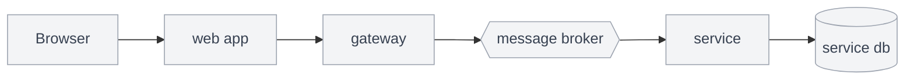
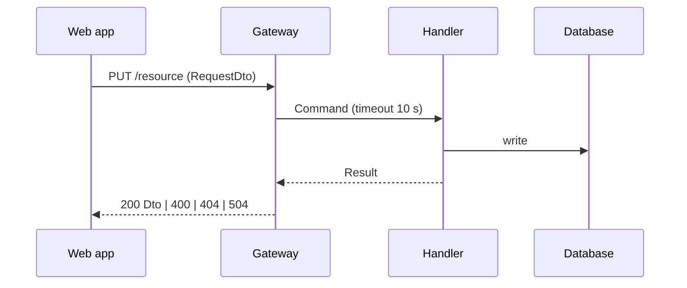
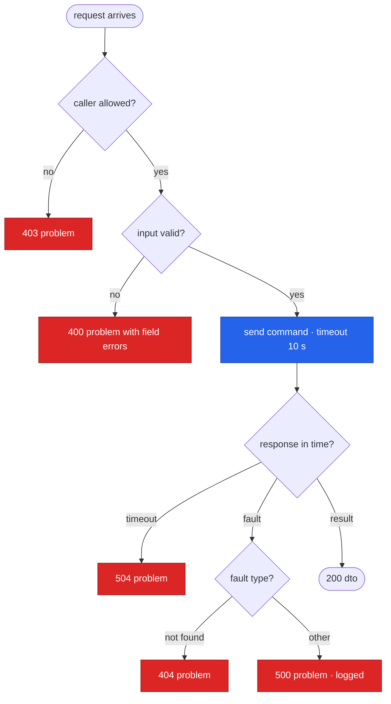
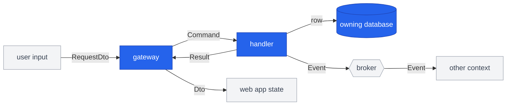
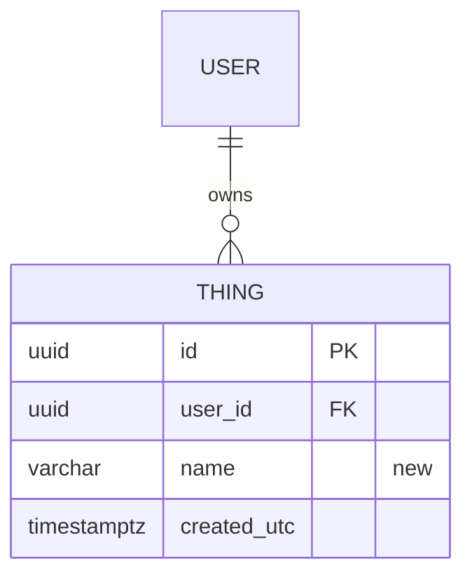
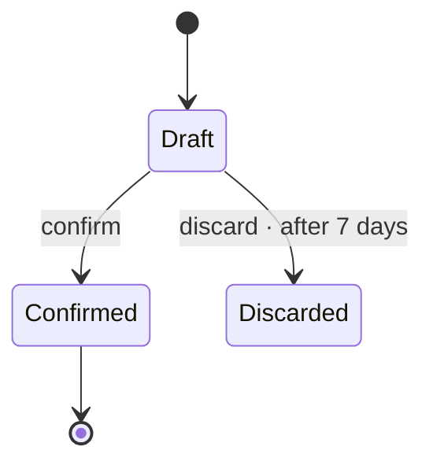

# <Feature title>

Issue: #<issue> · Plan: [plan.md](plan.md)

## 1. Problem

<!-- Condensed from the issue, not rewritten. Acceptance criteria verbatim. -->

**Acceptance criteria** (from the issue)

- [ ] ...

## 2. Spec

<!-- No code without this section. Four questions, each answered so that someone who has not
     read the rest of the document could check it. A reviewer blocks the design if any of the
     four is missing, vague ("works correctly", "nothing breaks") or untestable. -->

### 2.1 What the change does

<!-- Observable behaviour after the change, from the outside: who does what, what they get.
     Numbered statements (S1, S2, …) so the plan and the tests can cite them. Not how it is built. -->

- **S1** — When <actor> <does something>, <observable result>.
- **S2** — ...

### 2.2 How we'll know it works

<!-- For each S-statement and each acceptance criterion: the evidence that proves it. A named
     automated test where possible; otherwise a manual check with its expected result, or a
     production signal (metric, log line, dashboard panel) with the value that means "working". -->

| Proves | Evidence | Kind |
|---|---|---|
| S1, AC1 | `<TestClass.Method>`: <what it asserts> | unit / integration / e2e |
| S2 | <metric or query> = <expected value> after deploy | production signal |

### 2.3 What it must not break

<!-- The existing behaviour, contracts, data and guarantees this change sits next to and must leave
     intact. Numbered (N1, N2, …). Each names what guards it: an existing test (cite it), a new
     regression test, a compatibility rule, or a check after deploy. "Nothing" is not an answer;
     name the closest neighbours. -->

| # | Must keep working | Guarded by |
|---|---|---|
| N1 | <existing behaviour or contract, e.g. old clients still read the response> | existing `<Test>` / new `<Test>` / check |
| N2 | <data or invariant, e.g. existing rows keep their values through the migration> | |

### 2.4 How we'll debug it at 3 am

<!-- If I were on call at 3 am and this broke, what observability would I need to solve it?
     One row per realistic failure mode (from the control flow and the caveats). On-call has the
     dashboards, logs and traces, not the code. Each signal is produced by a plan task. -->

| # | When this fails | How we find out | What localises it | What it tells us · first action |
|---|---|---|---|---|
| O1 | <failure mode, e.g. the call to Payments times out> | <alert and threshold, or the symptom a user reports> | <log line with its fields (ids, correlation/trace id, elapsed), metric with labels, trace span> | <which record, which dependency, which step · what on-call does first> |

## 3. Where it fits

<!-- Copy the project's system-base.mmd; `:::affected` on every node this feature changes,
     `:::new` for what it introduces, the rest `:::quiet`. Labels on one line. -->

## 4. Main flow

<!-- One sequence diagram per user-visible flow. Name routes, types, messages, handlers, timeouts, statuses. -->

## 5. Control flow

<!-- Authorisation, validation, branches, errors, retries, timeouts, duplicate delivery.
     Every branch ends in an observable outcome. `flowchart TD`. -->

## 6. Data flow

<!-- Sources, contracts, owning stores, and how data crosses context boundaries. Label every edge. -->

## 7. Data model and states

<!-- erDiagram for the schema delta (mark owners); stateDiagram-v2 for lifecycles; or "n/a — reason". -->

## 8. Affected parts

| Project | Kind of change | Version bump | Migration | Generated clients |
|---|---|---|---|---|
| | new / additive / behaviour / schema | yes / no | name or no | yes / no |

## 9. Caveats to consider

<!-- Every row from references/caveats.md (core + the profile's packs + project rows),
     answered or "n/a — reason", with the file you opened. A caveat that names something existing
     the change could break also belongs in 2.3; a new failure mode belongs in 2.4. -->

| Caveat | Answer |
|---|---|
| | |

### 9.1 Concurrency and idempotency

<!-- Required when the feature writes state or adds/changes a consumer, job, saga or loop.
     Each row: the mechanism, the code it relies on, the observable outcome. Say what is deferred. -->

**Idempotency: the same work arriving twice**

| Kind of duplicate | Covered by | Outcome |
|---|---|---|
| Same message or job redelivered (retry, crash before ack, restart) | | |
| Same message on two replicas at once | | |
| Failure partway through (after some writes, before publish or commit) | | |
| Duplicate event from the producer | | |
| Side effects outside the database (e-mail, blob, search, external API) | | |
| New request with the same intent (double-click, client or gateway retry) | | |
| Redelivery after the deduplication window | | |

**Concurrency: different actors touching the same state**

| Situation | Covered by | Outcome |
|---|---|---|
| Two writers on the same row | | |
| Several saves inside one request or consume | | |
| Work running on more than one replica (static state, schedulers, sweeps, claims) | | |
| Several events for one saga instance or aggregate at once | | |
| Locks or transactions held across a network call | | |
| Work longer than the broker's ack or visibility timeout | | |
| Ordering assumed between two messages | | |

## 10. Decisions

### 1. <Decision>

**Decision:** ...

**Rationale:** ... (rejected alternative: ...)

## 11. Out of scope / Open questions

- ...

## 12. Review outcome

### Risk map (look here first)

_Not yet reviewed._

### Problematic patterns

_Not yet reviewed._

### Findings

_Not yet reviewed._
